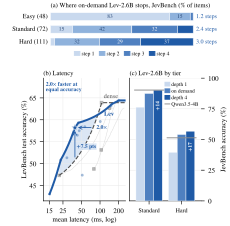

# Lev: one checkpoint, multiple depth operating points

[Project website](https://openlair.github.io/lev/) · [Paper](https://openlair.github.io/lev/#paper) · [GitHub](https://github.com/OpenLAIR/lev) · [Hugging Face collection — private](https://huggingface.co/collections/songdj/lev-thinking-fast-and-deep-with-looped-decision-models-6acefb135880c9d373cf42ba)

Lev turns pretrained recurrent language models into typed decision models. A shared pointer head returns one probability per option after each recurrent step, without generating an answer string. The same checkpoint provides several accuracy–compute operating points.

**Research release candidate.** Source code is maintained under [OpenLAIR/lev](https://github.com/OpenLAIR/lev). The linked Hugging Face collection and seed-0 model repositories are private; dataset releases and the arXiv identifier remain pending. Weights and question text are not bundled. See [resource availability](docs/RESOURCES.md) and [release status](docs/RELEASE_STATUS.md).

| Model | Backbone | Supported native depths | Hugging Face repository (private) |
|---|---|---|---|
| Lev-1.4B | Ouro-1.4B | 1–4 | [songdj/Lev-1.4B](https://huggingface.co/songdj/Lev-1.4B) |
| Lev-2.6B | Ouro-2.6B | 1–4 | [songdj/Lev-2.6B](https://huggingface.co/songdj/Lev-2.6B) |
| Lev-3B | Nanbeige4.2-3B-Base | 1–2 | [songdj/Lev-3B](https://huggingface.co/songdj/Lev-3B) |

On JevBench's 231 public tasks, Lev-2.6B improves from 63.2% at depth 1 to 76.2% at depth 4. An agreement stopper supports **offline** analysis of which questions could exit early. Its benefit over a matched fixed-depth frontier varies by workload: Lev-2.6B did not pass the locked LevBench G3 criterion. Latency comparisons depend on the measured implementation and hardware.



*Figure 1 from the study; adaptive points summarize offline routing analysis.*

## Install

Use Linux and Python 3.12 or 3.13. Create a new environment; the distribution is named `lev`, while Python imports remain `kev`.

```bash
python3.13 -m venv ../lev-env
source ../lev-env/bin/activate
python -m pip install --upgrade pip
cp -R . ../lev-work
python -m pip install '../lev-work[dev]'
(cd ../lev-work && PYTHONDONTWRITEBYTECODE=1 OMP_NUM_THREADS=1 MKL_NUM_THREADS=1 python -m pytest -q -p no:cacheprovider)
```

The CPU tests use tiny randomly initialized models and require no downloads or pretrained weights. [INSTALL.md](docs/INSTALL.md) records tested dependency versions, optional CUDA kernels for hybrid dense controls, and the pinned JevBench installation. The original environment's lockfile is not reused for this differently scoped package.

## Fixed-depth quick start

After obtaining a checkpoint directory containing `adapter_config.json`, adapter weights, and `head.pt`:

```bash
python examples/fixed_depth.py --checkpoint ../lev-weights/Lev-2.6B --depth 2 --device cuda
```

The example uses an original two-option toy question. `Checkpoint.load` loads the pinned backbone from the Hub; cache it first for offline use. The CLI supports `--all-depths` to read all outputs in one full-depth pass. **All-depth output does not save computation.** A chosen fixed depth uses only that number of recurrent steps.

```python
from kev.checkpoint import Checkpoint, LoadOptions

tokenizer, model = Checkpoint('../lev-weights/Lev-2.6B').load('cuda', LoadOptions(temperature=1.0))
model.set_depth(2)
```

Per-depth calibration temperatures are a separate JSON artifact, not implied by `head.pt`'s scalar temperature. The existing seed-0 calibration JSON files are in `calibration/`; for Lev-2.6B, supply `--temperatures calibration/Lev-2.6B-s0.json` after verifying checkpoint identity. Without it, the example prints uncalibrated softmax scores.

## Reproduction

- [Data and exact-input requirements](docs/DATA.md): source revisions, manifest hashes, training subsets, and distribution restrictions.
- [Training, readouts and offline stopping](docs/REPRODUCING.md): portable commands and the distinction between cross-fitting and deployment calibration.
- [Paper figures](figures/README.md): runnable aggregate-input redraws and an honest inventory of remaining inputs.
- [Model cards](model-cards/) and [dataset cards](data-cards/): release drafts, provenance and limitations.
- [Source and weight licenses](docs/LICENSING.md): source code is Apache-2.0; dataset and backbone terms are separate.

```bash
PYTHONDONTWRITEBYTECODE=1 python figures/reproduce.py --output-dir ../lev-figures
PYTHONDONTWRITEBYTECODE=1 python scripts/verify_release.py --mode hygiene
# Default release mode intentionally fails while readiness conditions remain blocked.
PYTHONDONTWRITEBYTECODE=1 python scripts/verify_release.py
```

Keep installation build files, environments, downloads and generated outputs outside a pristine artifact snapshot used for validation. The checker requires Gitleaks 8.30.1 and PyYAML; it ignores no files or directories. See [gate semantics](docs/RELEASE_STATUS.md).

This candidate includes adapted analysis code and existing study aggregate results. It does not bundle the complete per-question result collection or provide online adaptive state continuation. Never use locked test outcomes to choose a new rule or checkpoint.

## Citation and attribution

Paper title: **Lev: Thinking Fast and Deep with Looped Decision Models**. Authors: Dingjie Song, Zhiling Yan, Yuxuan Zhang, and Lichao Sun. The arXiv identifier and final citation will be added when assigned. See the [paper section](https://openlair.github.io/lev/#paper) for paper and citation updates.

Derived from [Jared Palmer's Kev](https://github.com/jaredpalmer/kev). See [NOTICE](NOTICE) and [LICENSE](LICENSE).
